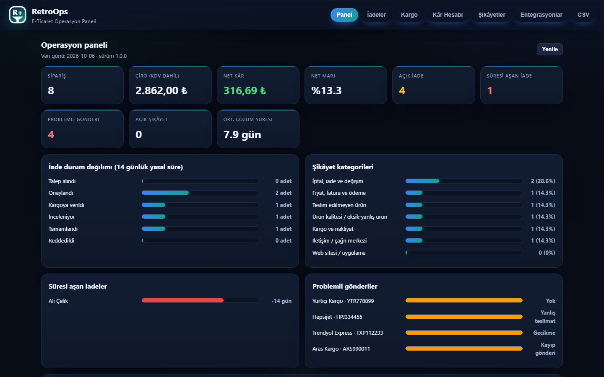
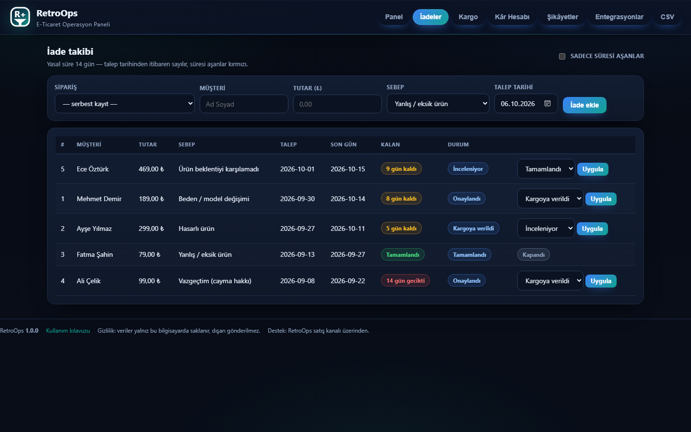
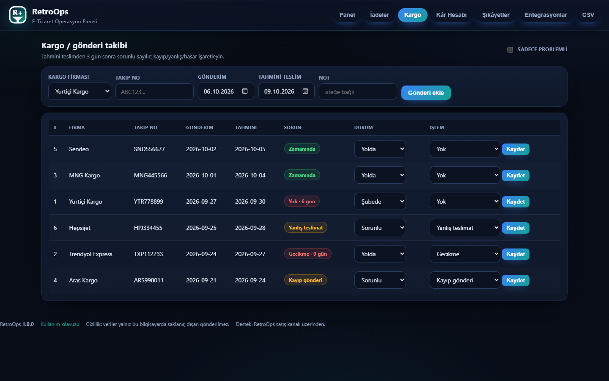
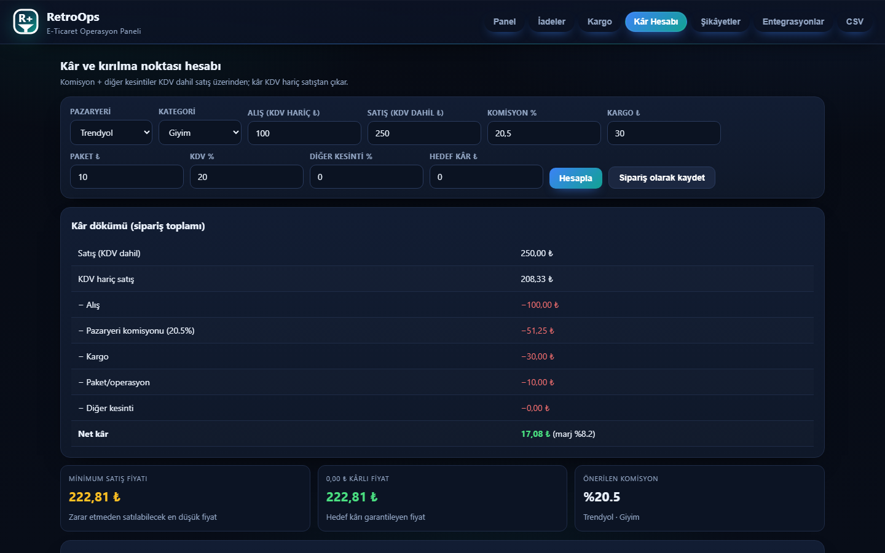
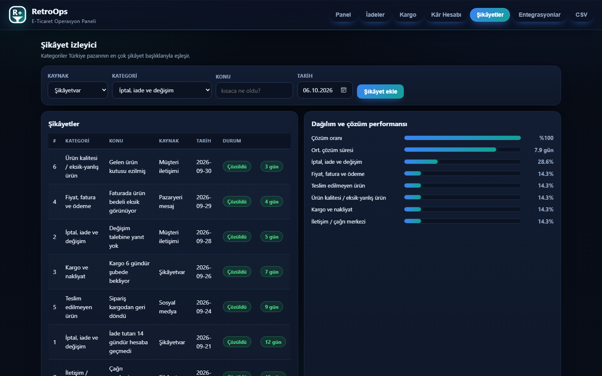
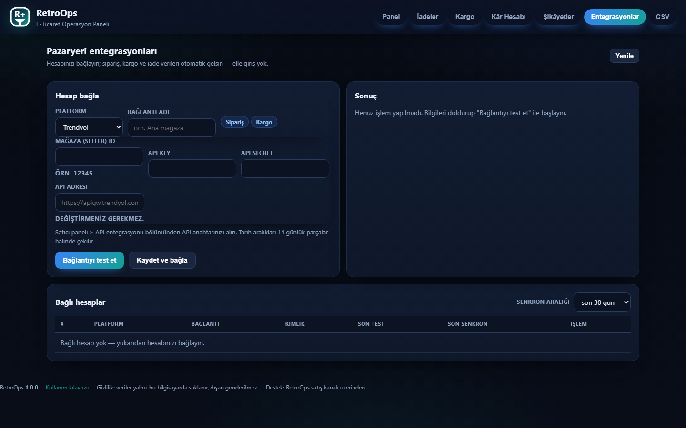
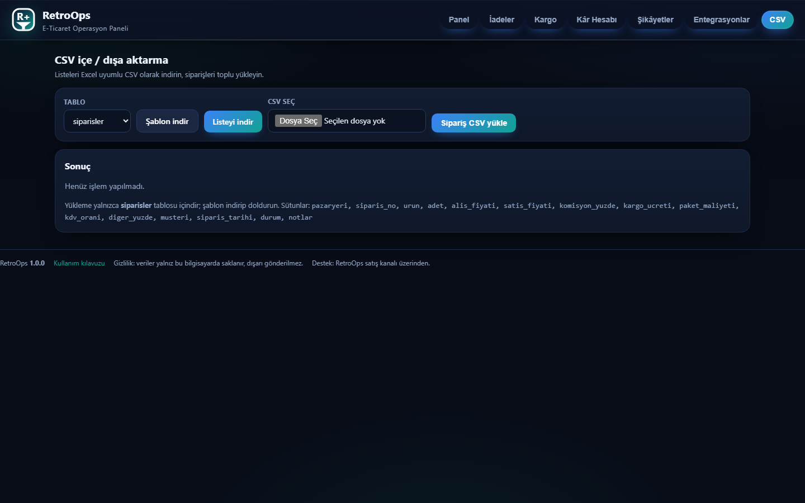
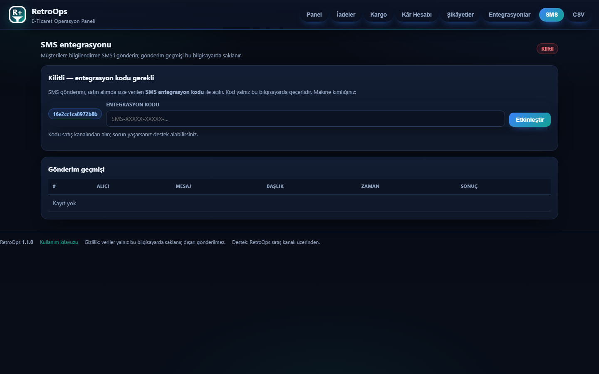
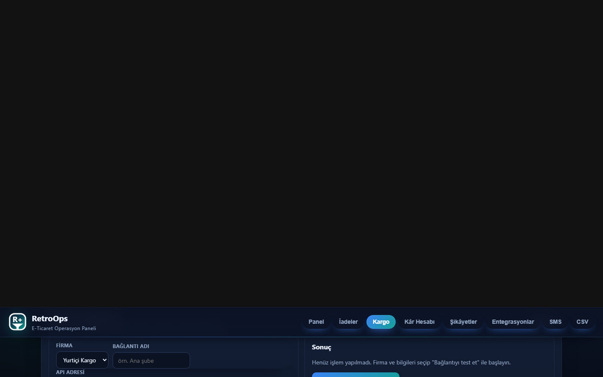

# RetroOps · E-Ticaret Operasyon Paneli

> **EN:** RetroOps — Turkish e-commerce operations dashboard: returns
> tracking, shipping-issue board, profit & break-even calculator, complaint
> monitor and marketplace integrations. Windows desktop app (14-day free
> trial) **with full source code in this repo** — Python stdlib + SQLite,
> fully offline, no external dependencies.

**İade takibi, kargo problem panosu, kâr/kırılma noktası hesabı, şikâyet
izleyici ve pazaryeri entegrasyonları** — hepsi tek, sade bir panelde.
Windows için hazırlanmış masaüstü uygulamasıdır; **Python, kurulum sihirbazı
veya teknik bilgi gerekmez.**

> Bu depo RetroOps'un **tek deposudur**: hazır program **Releases**
> bölümünden indirilir, kaynak kod, testler ve kullanım kılavuzu aynı
> depoda bulunur. Program ücretsiz **14 gün denenebilir**; süresi dolunca
> satış kanalından alınan lisans anahtarıyla çalışmaya devam eder.

## İndirme

➡️ **[Releases sayfasından en son sürümü indirin](https://github.com/RetroNyym/RetroOps/releases)**

Paket tek dosyadır: `RetroOps.exe` her şeyin içine gömülmüştür; ek DLL,
kütüphane veya çerçeveler gerekmez. Paket içinde ayrıca kullanım kılavuzu
(`KILAVUZ.md`) bulunur.

## Kurulum (2 dakika)

1. `RetroOps-vX.Y.Z.zip` dosyasını bir klasöre çıkarın — ya da zip'i hiç
   açmadan **zippeden doğrudan** `RetroOps.exe`'ye çift tıklayın.
2. **RetroOps masaüstü penceresi** açılır (tarayıcı değil; adres çubuğu yok).
   İkon RetroOps **R+** logosudur.
3. Hiçbir ayar gerekmez: deneme otomatik başlar, ilk ekranda size hangi
   adımı atacağınız söylenir.
4. **Entegrasyonlar** sekmesinden hesaplarınızı bağlayın → **Test** →
   **Senkronize et**. **Kargo** ve **SMS** sekmelerinden de bağlantılarınızı
   kurabilirsiniz.

Pencere, Windows 10/11'de yerleşik **WebView2** ile açılır; pywebview/.NET
çalışmazsa program otomatik olarak **Edge uygulama penceresinde** (adres
çubuksuz), o da yoksa tarayıcıda açılır ve çalışmaya devam eder.
Tarayıcı modunu isteyen `RetroOps.exe --tarayici` yazabilir.

Veriler program yanındaki `data/ops.db` dosyasında tutulur; program zip
içinden ya da geçici bir klasörden çalıştırılıyorsa veriler otomatik olarak
`%LOCALAPPDATA%\RetroOps\data\` altına yazılır (hiçbir koşulda kaybolmaz).

> **Windows SmartScreen/Defender uyarısı** çıkarsa: *Daha fazla bilgi* →
> *Yine de çalıştır*. Program imzasızdır; bu, yeni dağıtılan uygulamalarda
> normal bir uyarıdır.

**Sistem gereksinimleri:** Windows 10 veya 11 (64 bit), internet bağlantısı.
Başka hiçbir şey gerekmez.

## Ekran görüntüleri

| Panel | İadeler |
|---|---|
|  |  |

| Kargo | Kâr hesabı |
|---|---|
|  |  |

| Şikâyetler | Entegrasyonlar |
|---|---|
|  |  |

| CSV yükleme/dışa aktarma | SMS entegrasyonu |
|---|---|
|  |  |

| Kargo API bağlantıları |
|---|
|  |

Görseller `python araclar/goruntu_al.py` ile **headless tarayıcıda** üretilir:
masaüstüne hiç dokunmadan, her sekmeyi `#sekme` derin bağlantısıyla açarak
(ör. `http://127.0.0.1:8786/#iade`) 1440×900 yakalar.

## Sekmeler

| Sekme | Ne yapar | Çözdüğü problem |
|---|---|---|
| **Panel** | Ciro, net kâr, marj, açık/geciken iade, problemli gönderi, şikâyet dağılımı ve ort. çözüm süresi kartları; **satış listesi**: her satışta KDV oranı, otomatik KDV tutarı ve KDV sonrası net kâr, altında toplam ciro + toplam KDV + toplam KDV sonrası net kâr; **Lisans** (deneme/anahtar) ve **Veri & Yedek** panelleri | "Nerede yanıyorum?" |
| **İadeler** | 14 günlük yasal süre sayacı, `talep → onay → kargoya verildi → inceleme → tamamlandı` durum makinesi, süresi aşanlar kırmızı | Şikâyetlerin %63'ü iade-değişim |
| **Kargo** | Gönderi + takip no, tahmini teslimden 3 gün sonra otomatik gecikme; kayıp/yanlış/hasar işaretleme; "sadece problemli" filtresi; **Kargo API bağlantıları** paneli: 6 kargo firması (Yurtiçi, Aras, MNG, Sürat, Sendeo, PTT) hesabını bağla, **Test** ile canlı yanıt dene, **Senkronize et** ile takip numaralarını sorgula ve gönderi durumlarını otomatik güncelle | Teslimat gecikmesi / kayıp gönderi |
| **Kâr Hesabı** | Komisyon + kargo + paket + KDV + diğer kesintilerle net kâr; **minimum (kırılma) fiyatı** ve hedef kârlı fiyat; 2026 komisyon tablosu | Komisyon oranlarının yükselmesi, fiyat hassasiyeti |
| **Şikâyetler** | Türkiye pazarının başlıklarıyla kayıt, çözüm oranı ve ort. çözüm süresi | Müşteri şikâyet takibi |
| **Entegrasyonlar** | 9 pazaryeri/servis API hesabını **bağla** (Trendyol, Hepsiburada, N11, ÇiçekSepeti, Shopier, Pazarama, Shopify, WooCommerce, Amazon); şifreli sakla, **Test** ile bağlantıyı dene, **Senkronize et** ile sipariş/kargo/iade kayıtlarını otomatik çek | Manuel sipariş girişi ve takip no kopyalama |
| **CSV** | Tablo listesini Excel uyumlu indir, şablon al, siparişleri toplu yükle | Elle tek tek giriş yok |
| **SMS** | Netgsm üzerinden toplu/tekil SMS gönderimi; **kilitli gelir**, satıcıdan alınan imzalı aktivasyon koduyla açılır; gönderici başlığı, kullanıcı adı ve API şifresi kaydedilir; gönderim geçmişi | Müşteriye bilgilendirme SMS'i, kargo/iade hatırlatması |

## Geliştirici başlangıcı

**Geliştirme sunucusu (Python 3.x, harici bağımlılık yok):**

```powershell
git clone https://github.com/RetroNyym/RetroOps.git
cd RetroOps
python -m ops.ornek_veri     # ilk açılış için demo veri (opsiyonel)
python -m ops.web 8780       # veya: baslat.bat
# tarayıcıda: http://127.0.0.1:8780
```

`baslat.bat` → panel / örnek veri / test menüsü.

`.exe` derlemesi (tek dosya, masaüstü penceresi + R+ ikon + dosya sürümü):

```powershell
pyinstaller --onefile --windowed --name RetroOps --icon retroops.ico `
  --version-file surum_bilgisi.txt --add-data "KILAVUZ.md;." --add-data "retroops.ico;." baslat_exe.py
```

(çıktı `dist/RetroOps.exe`; `pywebview` kurulu olmalı; onedir isteyen
`--onedir` yazabilir)

Paket içeriği: `RetroOps.exe` (18 MB, tek dosya), `KILAVUZ.md`, `LICENSE.txt`,
`retroops-logo.png`.

## Mimari

```
RetroOps/
  ops/
    db.py          SQLite şeması + şema geçişi (OPS_DB ortam değişkeni test içindir)
    kar.py         2026 komisyon tabloları, kâr dökümü, minimum/hedefli fiyat
    iade.py        14 gün sayacı + durum makinesi (geçişler katı)
    kargo.py       Gecikme eşiği, problem listesi, sorun tipleri
    sikayet.py     Kategori/çözüm istatistikleri
    csv_io.py      Şablon, toplu yükleme, dışa aktarma (UTF-8 BOM, Excel uyumlu)
    ornek_veri.py  Demo veri (idempotent: doluysa dokunmaz)
    entegrasyon.py Platform listesi, bağlantı CRUD, şifreli saklama, test/senkron
    adapters/      9 platform adaptörü (temel.py + trendyol, hepsiburada, n11,
                   ciceksepeti, shopier, pazarama, shopify, woocommerce, amazon)
    sync.py        Adaptör çıktısını sipariş/gönderi/iade tablolarına yazar
    kargo_api.py   6 kargo firması (Yurtiçi/Aras/MNG/Sürat/Sendeo/PTT) API
                   spesifikasyonu, canlı test, takip sorgu + otomatik senkron
    sms.py         Netgsm SMS: imzalı aktivasyon kodu, şifreli gönderici ayarları,
                   gönderim + geçmiş
    guncelleme.py  Public GitHub sürüm dosyasından uzaktan güncelleme kontrolü
                   (6 saat önbellek, ağ hatası sessiz)
    sifre.py       Kimlik sırlarını şifreler (Fernet varsa, yoksa stdlib PBKDF2+HMAC)
    sayfa.py       Panel HTML/CSS/JS + RetroOps SVG logo
    web.py         http.server JSON API
  data/ops.db      Veritabanı (ilk çalıştırmada oluşur)
  test_*.py        101 test
  baslat.bat, README.md, requirements.txt
```

## API

| Metot | Yol | Not |
|---|---|---|
| GET | `/api/meta` | Durum/kategori listeleri (arayüz bununla dolar) + lisans durumu |
| GET/POST | `/api/lisans` | Deneme/lisans durumu / anahtar etkinleştirme (makineye bağlı) |
| GET | `/kilavuz` | Kullanım kılavuzu (KILAVUZ.md'den üretilir) |
| GET | `/api/yedek/indir` · POST `/api/yedek/yukle` · POST `/api/yedek/geri_al` | Veritabanı yedeği indir / yükle (doğrulanır) / geri al |
| GET | `/api/ozet` | Panel kartları + istatistikler |
| GET/POST | `/api/siparisler` | Liste (`?limit=200` ile son N) / ekle (kâr hesabıyla birlikte) |
| GET/POST | `/api/iadeler?sadece=geciken` | Liste / ekle |
| POST | `/api/iadeler/{id}/durum` | `{durum}` — geçersiz geçiş 400 döner |
| GET/POST | `/api/gonderiler?sadece=problem` | Liste / ekle |
| POST | `/api/gonderiler/{id}/durum` | `{durum, sorun_tipi}` |
| GET/POST | `/api/sikayetler` · POST `/api/sikayetler/{id}/durum` | Kayıt / çözüm |
| POST | `/api/hesapla` | Kâr dökümü + minimum + hedefli fiyat |
| GET | `/api/komisyonlar` | Komisyon tablosu (kâr hesabı) |
| GET/POST | `/api/entegrasyonlar` | 9 pazaryeri platformu + kayıtlı bağlantılar (kargo API kayıtları bu listeden ayrılır, sır asla dönmez) |
| POST | `/api/entegrasyonlar/test` | Taslak test: `{platform, ayarlar, kimlik}` |
| POST | `/api/entegrasyonlar/{id}/test` · `/{id}/senkron` · `/{id}/sil` | Test / `{gun:1..90}` senkron / sil |
| GET | `/api/kargo/api` | 6 kargo firması spesifikasyonu + kayıtlı bağlantılar |
| POST | `/api/kargo/api` · `/api/kargo/api/test` | Yeni bağlantı (201) / taslak test: `{firma, taban_adres, ayarlar, kimlik…}` |
| POST | `/api/kargo/api/{id}/test` · `/{id}/sil` | Kayıtlı bağlantıda canlı test (2xx/4xx/5xx döner) / sil |
| POST | `/api/kargo/senkron` | `{id?, kimlik?, tur}` — takip numaralarını sorgula, durumları güncelle |
| GET | `/api/sms` | Aktivasyon durumu, gönderici ayarları (parola asla dönmez), gönderim geçmişi |
| POST | `/api/sms/etkinlestir` · `/api/sms/kaldir` | İmzalı aktivasyon koduyla aç / kapat |
| POST | `/api/sms/ayar` · `/api/sms/gonder` | Gönderici kaydı / `{alici, mesaj, baslik?}` gönder |
| GET | `/api/guncelleme` | Public `surum.json` ile karşılaştırma (6 saat önbellek) |
| GET | `/api/export/csv?tablo=` · `/api/sablon?tablo=` | İndirme |
| POST | `/api/import/csv?tablo=siparisler` | Ham CSV gövdesiyle toplu yükleme |

## Test

```powershell
python -m pytest -q          # 101 test
python -m pyflakes ops       # 0 hata
python kontrol_ara.py        # JS <-> HTML id bütünlüğü
python kontrol_api.py        # JS yolları <-> sunucu rotaları
```

## Sürüm yayınlama

```powershell
# 1) kod değişikliği bittikten sonra exe'yi derle (aşağıdaki komut)
# 2) testler + kontroller
python -m pytest -q ; python -m pyflakes ops
# 3) surum.json'u güncelle (surum + indirme URL'i) — bu depoda, main'e commit
# 4) release oluştur ve dosyaları yükle
gh release create v1.2.0 RetroOps-v1.2.0.zip RetroOps.exe `
  --repo RetroNyym/RetroOps --title "RetroOps 1.2.0" --notes "..."
```

Güncelleme kontrolü `ops/guncelleme.py` üzerinden bu depodaki `surum.json`
dosyasını okur. 1.1.0 öncesi eski yapımlar artık var olmayan eski sürüm
deposuna bakıyordu; bu yapımlarda güncelleme bandı görünmez, program
etkilenmez (ağ hatası gibi sessizce geçer).

## Notlar

- **Kâr formülü:** Komisyon ve diğer kesintiler KDV *dahil* satış üzerinden;
  kâr = KDV hariç satış − alış − komisyon − kargo − paket − diğer. Minimum fiyat bu
  denklemin kâr=0 çözümüdür (komisyon paydası silerse anlaşılır hata döner).
- **Otomatik KDV:** Her siparişin `kdv_orani` alanı esas alınır (yoksa %20); satır bazlı
  KDV tutarı ve KDV sonrası net kâr `/api/siparisler`, toplam KDV `/api/ozet`
  (`kdv_tutar`) üzerinden hesaplanır ve Panel'de satış listesinde gösterilir.
- **Yasal süre:** İade için 14 gün (Tüketiciyi Koruma Kanunu) `talep_tarihi + 14`
  olarak sayılır; `cozum_tarihi` terminal durumlarda otomatik yazılır.
- **Entegrasyon:** API anahtarları/şifreleri `data/.anahtar` dosyasıyla şifrelenerek
  saklanır ve hiçbir API yanıtında/ekranında geri dönmez (yalnız doluluk bilgisi);
  `cryptography` kuruluysa Fernet, yoksa aynı biçimde stdlib PBKDF2+HMAC ile çalışır.
  "Senkronize et" aynı siparişi ikinci kez satır yapmaz (kaynak + platform sipariş
  no ile tekilleşir); okunamayan yanıt için `uyari`, 4xx/5xx için `hata`, ağ/SSL
  hatası için `ag` sonucu döner — hiçbir sekme boş kalmaz.
- **SMS (Netgsm):** SMS sekmesi baştan kilitli görünür; satıcı
  `araclar/sms_kodu_uret.py` ile makine kimliğine bağlı imzalı kod üretir,
  müşteri kodu girince sekme açılır. Gönderici bilgileri `data/.sms`
  dosyasında şifreli tutulur, arayüze/yanıta yalnız `parola_var` döner.
  Gönderimler `sms_gonderim` tablosuna yazılır; HTTP hataları dahil her sonuç
  geçmişte görünür. Aktivasyon `data/.sms` dosyasını silmeden `kaldir` ile geri
  alınabilir; aynı makine için kod yeniden üretilebilir.
- **Kargo API:** Bağlantılar ayrı tablo değil, `entegrasyonlar` tablosunda
  `kargo_` önekli platform olarak saklanır; `kargo_api.py` içindeki spesifikasyon
  firmaların uçlarını tanımlar (zorunlu alanlar: `tabanAdres`; opsiyonel:
  `sorguYolu`, `takipAlani`, kimlik türü Basic/Bearer). Firma spesifik
  dokümanlar/ uçlar müşteri tarafından girilir — panel kendi ağında çalıştığı
  için canlı firma doğrulaması yapmaz, **Test** düğmesi verilen uçla gerçek HTTP
  isteği atar. Durum metni Türkçe/İngilizce anahtar kelimelerle eşleştirilir ve
  `kargo.gonderi` durumuna yazılır; `senkron` en fazla 100 takip numarası sorgular.
- **Güncelleme:** `ops/guncelleme.py` bu depodaki `surum.json` dosyasını okur
  (varsayılan:
  `https://raw.githubusercontent.com/RetroNyym/RetroOps/main/surum.json`),
  sonucu 6 saat önbellekler ve panel üstünde "Yeni sürüm var" bandı gösterir.
  Uzak sürüm yerel sürümle aynıysa bant çıkmaz; ağ hatasında sessizce geçer
  (panel çalışmaya devam eder). `OPS_GUNCELLEME=yok` ile kapatılabilir,
  `OPS_GUNCELLEME_DOSYA` ile yerel dosyadan test edilebilir.
- **Lisans:** İlk açılıştan itibaren 14 gün deneme; süresi dolan program yalnız
  `/api/meta`, `/api/lisans` ve `/kilavuz` uçlarını açık tutar, veri uçları
  `402` döner ve arayüz lisans ekranını gösterir. Anahtar `RETROOPS-…` biçiminde,
  HMAC-SHA256 imzalı ve makine kimliğine bağlıdır; satıcı `araclar/lisans_uret.py`
  ile üretir, durum `data/.lisans` dosyasında tutulur.
- **Yedek:** Panel → Veri & Yedek; `.db` dosyası indirilir/yüklenir, yüklemeden
  önce `PRAGMA integrity_check` + zorunlu tablo kontrolü yapılır, eski veri
  `.eski` dosyasında saklanır ve "Önceki veriye dön" ile geri alınır.
- **Dağıtım (tek dosya):** Ürün `dist/RetroOps.exe` (PyInstaller `--onefile`)
  olarak dağıtılır; tüm DLL'ler (`python314.dll`, VCRUNTIME, UCRT, WebView2
  yükleyicisi) exe'nin içindedir → "python314.dll bulunamadı / modül eksik"
  hataları oluşmaz, zip'ten çift tıklayınca bile çalışır. Veri kökü
  `ops.db.kok_dizin()` ile belirlenir: exe'nin yanındaki `data/` (normal
  kullanım) ya da kalıcı olması için `%LOCALAPPDATA%\RetroOps` (zip/temp/
  salt-okunur klasör). Beklenmeyen hatalar `data/hata.log`'a yazılır ve
  Türkçe bilgi penceresi gösterilir. Masaüstü penceresi (pywebview/.NET)
  açılmazsa **Edge uygulama penceresi**, o da yoksa tarayıcı devreye girer.
- **İmzasızlık:** Program imzalı olmadığı için Windows SmartScreen/Defender
  uyarısı verebilir; Defender program dosyalarını silerse program klasörüne
  "izlenme izni" verilmelidir (kılavuzda anlatılıyor).
- **Kılavuz:** `KILAVUZ.md` (son kullanıcıya yönelik) hem repoda hem pakette
  bulunur; `/kilavuz` adresinden program içinden de okunur.
- **Bilinen sınırlama:** Bazı ağlarda pazaryeri API uçlarına TLS doğrulaması
  engellendiğinden canlı uç testi yapılamıyor (bu ortamda Trendyol/Hepsiburada/N11
  el sıkışması kesiliyor); uygulama bunu "Ağ hatası" olarak raporlar ve diğer
  tüm akışlar aynı kalır. Satış öncesi müşteri ağından bir kez gerçek anahtarla
  **Test** çalıştırılmalıdır.
- Veritabanı elle taşınacaksa `OPS_DB` ortam değişkeniyle yol verilebilir.

## Lisans

Telif hakkı © 2026 RetroOps. **Tüm hakları saklıdır.**

Bu proje **açık kaynak değildir** (MIT vb. lisans değildir): kaynak kodu bu
depoda yayımlanmış olsa dahi lisanssız çoğaltma, değiştirme, yeniden yayınlama
veya ticari kullanım yasaktır. Son kullanıcı lisansı 14 gün deneme + anahtar
şeklindedir; kullanım ve dağıtım koşulları için `LICENSE.txt` dosyasına bakın.
